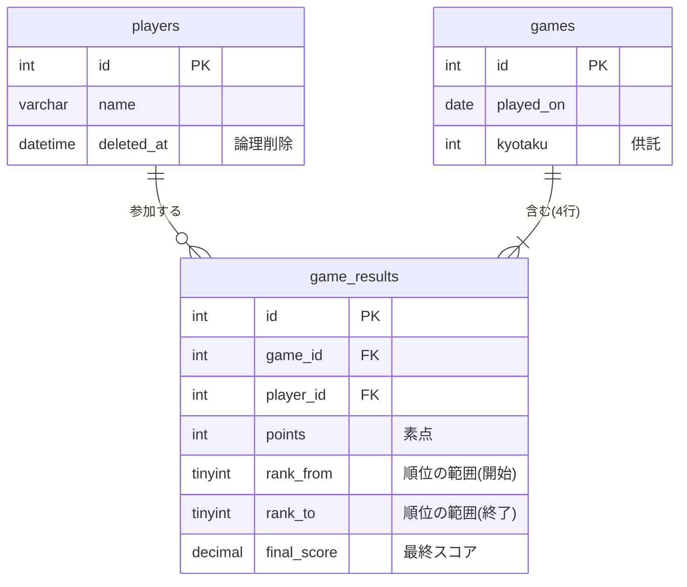
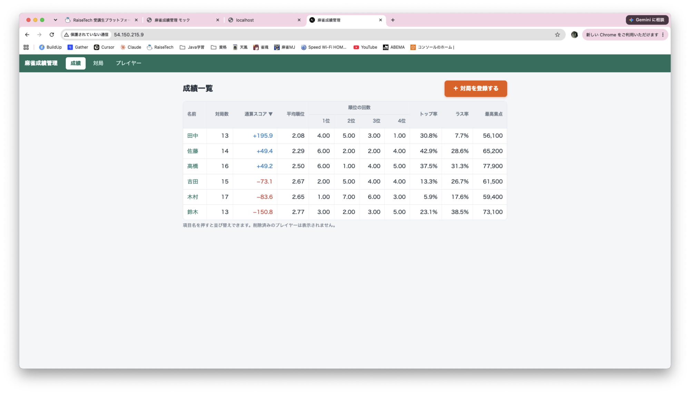
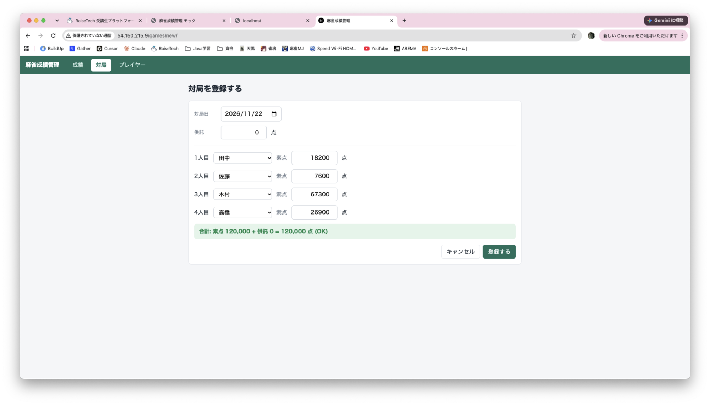
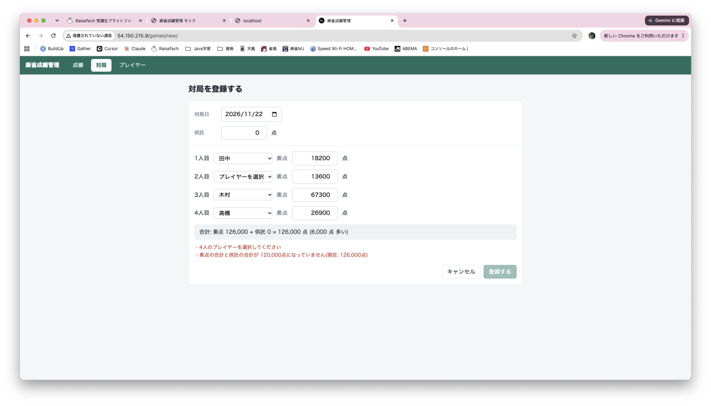
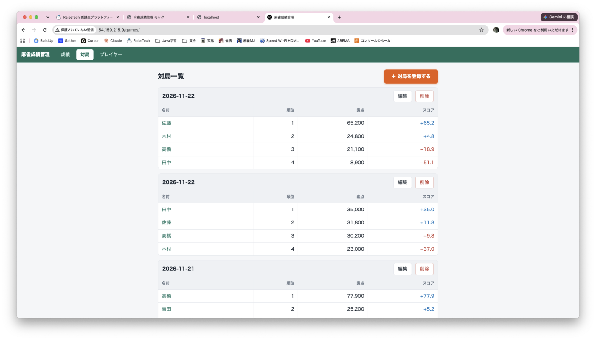
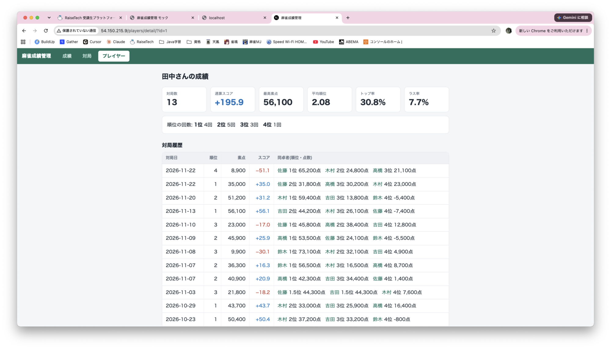

# 麻雀成績管理アプリ(mahjong-score-tracker)

麻雀(4人麻雀)の対局結果を記録して、プレイヤーごとの成績を集計・表示する Web アプリです。仲間内で複数人が使うことを想定していて、ログインは不要です(名前だけ登録します)。

RaiseTech AI エンジニアコースの最終課題として、アプリの設計・実装から AWS へのデプロイまでを行っています。

## 目次

- [できること](#できること)
- [麻雀のルールとスコア計算](#麻雀のルールとスコア計算)
- [画面](#画面)
- [技術スタック](#技術スタック)
- [プロジェクト構成](#プロジェクト構成)
- [設計書](#設計書)
- [ローカルでの動かし方](#ローカルでの動かし方)
- [AWS へのデプロイ](#aws-へのデプロイ)
- [AWS 上での動作確認](#aws-上での動作確認)
- [テストと品質チェック](#テストと品質チェック)
- [API の概要](#api-の概要)
- [開発の進め方](#開発の進め方)
- [今後の拡張](#今後の拡張)

---

## できること

| 機能 | 内容 |
|------|------|
| プレイヤー管理 | 名前だけでプレイヤーを登録・編集・削除できる。削除しても過去の対局は残り、「削除されたプレイヤー」と表示される(論理削除) |
| 対局の登録・編集・削除 | 対局日、4人分のプレイヤーと素点、供託を入力する。順位と最終スコアは自動で計算される |
| 対局一覧 | 対局を、日付の新しい順にカードで表示する |
| 成績一覧 | プレイヤーごとに、対局数・通算スコア・平均順位・順位の回数・トップ率・ラス率・最高素点を表示する。項目名を押すと並び替えられる |
| プレイヤー詳細 | そのプレイヤーの成績と、同卓者(名前・順位・点数)つきの対局履歴を表示する。どの対局だったかを思い出しやすい |

### 入力の安全策

- 4人全員の名前と素点がそろい、**「4人の素点の合計 + 供託 = 120,000点」** になるまで、対局は登録できません。
- 最終局が流局して供託(場に残った点数)が残ったまま終わる対局にも対応しています(供託を別に記録します)。
- 同じプレイヤーを同じ対局に二重に選べません。

---

## 麻雀のルールとスコア計算

最高位戦ルールで計算します。

| 項目 | 内容 |
|------|------|
| 持ち点 / 返し点 | 30,000点 / 30,000点(オカなし) |
| ウマ | 10-30(1位 +30、2位 +10、3位 −10、4位 −30) |

```
最終スコア = (素点 − 30,000) ÷ 1,000 + ウマ
```

計算例:

| 順位 | 素点 | 計算 | 最終スコア |
|------|------|------|-----------|
| 1位 | 42,500 | (42,500 − 30,000) ÷ 1,000 + 30 | +42.5 |
| 2位 | 31,000 | (31,000 − 30,000) ÷ 1,000 + 10 | +11.0 |
| 3位 | 28,000 | (28,000 − 30,000) ÷ 1,000 − 10 | −12.0 |
| 4位 | 18,500 | (18,500 − 30,000) ÷ 1,000 − 30 | −41.5 |

### 同点のときの扱い

素点が同じ人がいるときは、順位を平均で表し(例: 1位・2位が同点なら **1.5位**)、ウマは同点の人で**分け合います**。順位ごとの回数も、同点の人数で等分して数えます(1.5位なら、1位と2位に 0.5 回ずつ)。

| 同点のパターン | 順位の表記 | 各自のウマ |
|---------------|-----------|-----------|
| 1位・2位 | 1.5位 | (+30 +10) ÷ 2 = +20 |
| 2位・3位 | 2.5位 | (+10 −10) ÷ 2 = 0 |
| 3位・4位 | 3.5位 | (−10 −30) ÷ 2 = −20 |
| 1位〜3位の3人 | 2位 | (+30 +10 −10) ÷ 3 = +10 |
| 2位〜4位の3人 | 3位 | (+10 −10 −30) ÷ 3 = −10 |
| 4人全員 | 2.5位 | 0 |
| 1・2位の同点と、3・4位の同点が同時 | 1.5位 と 3.5位 | +20 と −20 |

詳しくは [機能要件](docs/機能要件.md) を参照してください。

---

## 画面

| 画面 | URL | 内容 |
|------|-----|------|
| 成績一覧(トップ) | `/` | プレイヤーごとの成績。項目名を押して並び替え |
| 対局一覧 | `/games/` | 対局のカード一覧。編集・削除 |
| 対局登録 | `/games/new/` | 入力フォーム。素点の合計を入力しながら確認できる |
| 対局編集 | `/games/edit/?id=1` | 登録済みの対局を直す |
| プレイヤー管理 | `/players/` | 登録・名前の編集・削除 |
| プレイヤー詳細 | `/players/detail/?id=1` | 成績と、同卓者つきの対局履歴 |

画面のイメージは、ブラウザで開けるモック([docs/mock/index.html](docs/mock/index.html))で確認できます。詳細は [画面設計](docs/画面設計.md) を参照してください。

---

## 技術スタック

| 分類 | 技術 | バージョン |
|------|------|-----------|
| フロントエンド | Next.js(App Router、静的エクスポート) | 16.4.6 |
| | React / TypeScript | 19.3.0 / 5 |
| バックエンド | Python / FastAPI | 3.15 / 0.165.0 |
| | SQLAlchemy(ORM) / Alembic(マイグレーション) | 2.1.9 / 1.20.1 |
| | Uvicorn(サーバー) / Pydantic(入力の検証) | 0.54.0 / 2 |
| データベース | MySQL | 8.0 |
| テスト・品質 | pytest、Ruff(バックエンド)/ Vitest、Testing Library、ESLint(フロントエンド) | |
| インフラ | AWS(EC2 1台 + Nginx + MySQL)、Terraform で構築、SSM で操作 | EC2 t3.micro / Amazon Linux 2023 |

### 構成の考え方

- **フロントエンド**は、Next.js の静的エクスポートで、HTML・CSS・JS のファイルに書き出して配信します。サーバー側で動く処理は持たず、ブラウザから API を呼んでデータを表示します。
- **バックエンド**は、REST API(JSON)を提供します。順位とスコアの計算、入力のチェックは、すべてバックエンドで行います(画面側のチェックは、すぐ気づけるようにするためのものです)。
- **データベース**は、プレイヤー(`players`)、対局(`games`)、対局ごとの各プレイヤーの結果(`game_results`)の3テーブルです。

---

## プロジェクト構成

```
mahjong-score-tracker/
├── backend/                  # FastAPI アプリケーション(ポート 8000)
│   ├── app/
│   │   ├── routers/          #   URL と HTTP メソッドの受け付け
│   │   ├── services/         #   ビジネスロジック(スコア計算・入力チェック・集計)
│   │   ├── schemas/          #   リクエスト/レスポンスの形(Pydantic)
│   │   ├── models/           #   DB のテーブル(SQLAlchemy)
│   │   └── errors.py         #   共通のエラー応答
│   ├── alembic/              #   DB マイグレーション
│   ├── tests/                #   テスト
│   └── requirements.txt
├── frontend/                 # Next.js アプリケーション(ポート 3000)
│   └── src/
│       ├── app/              #   画面(ページ)
│       ├── components/       #   共通の部品(対局フォーム、確認ダイアログなど)
│       └── lib/              #   API 呼び出し、表示の整形、入力チェック、並び替え
├── infra/                    # AWS の構築(Terraform)とデプロイスクリプト、Nginx 設定
├── docs/                     # 設計書、画面のモック、AWS デプロイ手順書、動作確認のスクリーンショット
├── CLAUDE.md                 # 開発のルール(AI アシスタント向け)
└── README.md
```

---

## 設計書

| ドキュメント | 内容 |
|-------------|------|
| [機能要件](docs/機能要件.md) | 機能一覧、麻雀のルール、スコア計算、同点の扱い |
| [DB設計](docs/DB設計.md) | テーブル定義、論理削除、順位の持ち方、集計 SQL |
| [画面設計](docs/画面設計.md) | 画面一覧、画面遷移、各画面のレイアウトと操作、入力チェック |
| [API設計](docs/API設計.md) | エンドポイント、リクエスト/レスポンス、エラー仕様 |

### DB(ER 図)



順位は、同点を正確に扱うため、「占める順位の範囲(開始と終了)」で保存しています(同点でなければ開始 = 終了)。

---

## ローカルでの動かし方

### 前提

動作確認した環境です。

- Python 3.15、Node.js 24(npm 11)、MySQL 8.0
- macOS

### 1. データベースを作る

MySQL に、アプリ用のデータベースとユーザーを作ります(root で入って実行します)。テスト用のデータベースも作ります。**テストは、テスト用のデータベースのテーブルを作り直すので、必ず本番用とは別にしてください。**

```sql
CREATE DATABASE mahjong_score_tracker CHARACTER SET utf8mb4 COLLATE utf8mb4_0900_ai_ci;
CREATE DATABASE mahjong_score_tracker_test CHARACTER SET utf8mb4 COLLATE utf8mb4_0900_ai_ci;
CREATE USER 'mahjong_app'@'localhost' IDENTIFIED BY '好きなパスワード';
GRANT ALL PRIVILEGES ON mahjong_score_tracker.* TO 'mahjong_app'@'localhost';
GRANT ALL PRIVILEGES ON mahjong_score_tracker_test.* TO 'mahjong_app'@'localhost';
```

### 2. バックエンドを起動する(ポート 8000)

```bash
cd backend
cp .env.example .env          # .env を開いて、パスワードを、手順1で決めたものに書き換える
python3 -m venv .venv
source .venv/bin/activate
pip install -r requirements-dev.txt
alembic upgrade head          # テーブルを作る
uvicorn app.main:app --reload --port 8000
```

- 動作確認: http://localhost:8000/api/health が `{"status":"ok"}` を返せば成功です。
- API を試せる画面(Swagger UI): http://localhost:8000/api/docs

### 3. フロントエンドを起動する(ポート 3000)

別のターミナルで実行します。

```bash
cd frontend
npm install
npm run dev
```

http://localhost:3000 を開くと、アプリが使えます。最初に、「プレイヤー」の画面で4人以上を登録してから、対局を登録してください。

> `.env`(パスワードを書いたファイル)は、`.gitignore` で Git の管理から外してあります。GitHub には上がりません。

---

## AWS へのデプロイ

Terraform で AWS の環境を作り、スクリプトでアプリを配置します。**詳しい手順とトラブルシューティングは、[AWSデプロイ手順書](docs/AWSデプロイ手順書.md)** にまとめています。

```
ブラウザ ──(HTTP 80番)──> Nginx ─┬─ /     → Next.js の静的ファイル
                                  └─ /api/ → FastAPI (127.0.0.1:8000) → MySQL 8.0 (127.0.0.1:3306)
                           （すべて EC2 1台の中）
```

| 項目 | 内容 |
|------|------|
| 構成 | EC2(t3.micro / Amazon Linux 2023)1台に、Nginx・FastAPI・MySQL をまとめて置く。RDS・ALB などの常時課金のものは使わない |
| 構築 | Terraform(EC2、セキュリティグループ、SSM 用 IAM、転送用 S3 の 10 リソース) |
| 接続 | SSH は使わず、SSM を使う(22 番ポートは開けない) |
| 公開範囲 | セキュリティグループで、**自分の IP からの 80 番のみ**許可 |
| バックエンド | uv で導入した Python 3.15 + systemd。起動のたびに `alembic upgrade head` でテーブルを最新にする |
| フロントエンド | 手元で `npm run build` し、できた `out/` を S3 経由で Nginx に配置する |

```bash
# リポジトリのルートで実行(事前準備・詳細は手順書を参照)
cd infra && cp terraform.tfvars.example terraform.tfvars   # my_ip_cidr を自分の IP に書き換える
terraform init && terraform apply && cd ..                  # AWS の環境を作る(課金が始まる)
bash infra/scripts/deploy-database.sh                       # MySQL
bash infra/scripts/deploy-backend.sh --setup                # バックエンド
bash infra/scripts/deploy-frontend.sh --setup               # フロントエンド
```

> 公開範囲を自分の IP に限定し、認証もないため、**確認が終わったら `terraform destroy` で削除します**(手順書の「終了時」を参照)。

---

## AWS 上での動作確認

2026-11-22 に、上の手順で AWS(東京リージョン)にデプロイして、ブラウザから動作を確認しました。アドレスバーが、AWS 上の EC2 の IP アドレス(`54.150.215.9`)になっている点に注目してください。

### 成績一覧

プレイヤーごとの成績です。スコアのプラスは青、マイナスは赤で表示します。



### 対局の登録

素点の合計と供託を足して 120,000 点になっていれば、緑の「OK」が出ます。



入力が正しくないときは、直すべき点を日本語で表示して、登録ボタンを押せなくします。次の例は、プレイヤーを選んでいない 2 人目と、合計が 126,000 点になっている状態です。



### 対局一覧

登録した対局が、日付の新しい順に並びます。



### プレイヤー詳細

通算の成績と、同卓者つきの対局履歴です。2026-11-03 の行のように、同点のときは「1.5位」と表示し、ウマを分け合って計算します。



---

## テストと品質チェック

```bash
# バックエンド(backend/ で、仮想環境を有効にして実行)
pytest              # テスト。テスト用のデータベースにマイグレーションを実行してから動く
ruff check .        # コードの書き方の検査

# フロントエンド(frontend/ で実行)
npm test            # テスト(Vitest)
npm run lint        # コードの書き方の検査(ESLint)
npm run build       # 静的ファイルを out/ に書き出せるか(型の検査も含む)
```

テストの方針です。

- **スコアの計算**は、DB にも API にも依存しない関数にして、機能要件の計算例(同点の全パターンを含む)を手計算した期待値でテストしています。
- **集計**は、同点の按分(1/3 など)を、小数の誤差が出ない分数で計算し、「1/3 を3回足してちょうど 1」になることをテストしています。
- **API** は、実際の MySQL(テスト用)に対して、ステータスコードと日本語のエラーメッセージまで確認しています。
- **画面**は、入力・クリック・キー操作を再現して、呼ばれる API と表示されるメッセージを確認しています。

---

## API の概要

ベース URL は `/api` です。詳細は [API設計](docs/API設計.md) を参照してください。

| メソッド | パス | 内容 |
|---------|------|------|
| GET | `/players` | プレイヤー一覧(削除済みを除く) |
| POST | `/players` | プレイヤー登録 |
| PUT | `/players/{id}` | 名前の変更 |
| DELETE | `/players/{id}` | 削除(論理削除) |
| GET | `/players/{id}` | プレイヤー詳細(成績と、同卓者つきの対局履歴) |
| GET | `/stats` | 成績一覧 |
| GET | `/games` | 対局一覧 |
| GET | `/games/{id}` | 対局1件の取得 |
| POST | `/games` | 対局登録(順位とスコアは素点から自動計算) |
| PUT | `/games/{id}` | 対局編集 |
| DELETE | `/games/{id}` | 対局削除 |
| GET | `/health` | 動作確認(DB への接続も確認) |

エラーは、`{ "message": "...", "errors": [{ "field": "...", "message": "..." }] }` の形で、画面にそのまま表示できる日本語のメッセージを返します。

---

## 開発の進め方

[CLAUDE.md](CLAUDE.md) に決めたルールで、開発しています。

- 作業は、**イシューの起票 → ブランチの作成 → 実装 → プルリクエスト → マージ**の順で行います。`main` への直接の変更は禁止です(GitHub のブランチ保護で強制しています)。
- ブランチ名は `{type}/#{イシュー番号}-{内容}`、コミットメッセージは `{type}: {日本語で内容}` の形にしています。
- 設計書(要件 → DB → 画面 → API)を先に作り、画面のモックで見た目を確認してから、バックエンド → フロントエンドの順に実装しました。

---

## 今後の拡張

最初のバージョン(MVP)には含めず、あとで追加できるものです。

- ログイン機能(ユーザーごとの権限)
- 期間・プレイヤーでの絞り込み
- スコアの推移などのグラフ表示
- スマートフォン向けの画面の最適化
- 3人麻雀、ルール(持ち点・ウマ)の設定変更
