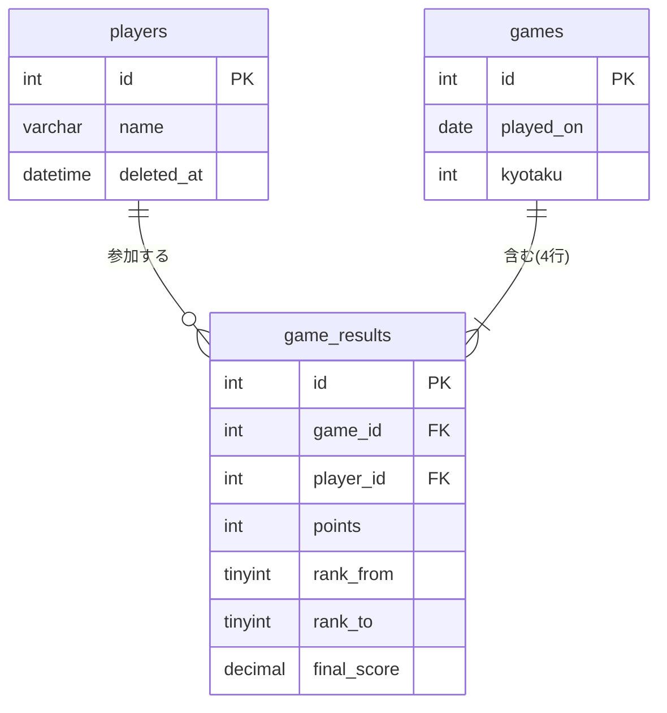

# DB設計

要件定義書([機能要件.md](機能要件.md))に基づく DB 設計。データベースは MySQL 8.0。

## 1. テーブル構成

| テーブル | 役割 |
|---------|------|
| players | プレイヤー(名前だけ。ログインなし) |
| games | 対局(対局日、供託) |
| game_results | 対局ごとの各プレイヤーの結果(1対局につき4行) |



### 1.1 3テーブルにした理由
対局のテーブルに4人分の素点を横に並べる(1人目〜4人目の列)と、「このプレイヤーの履歴」を調べるときに4つの列をすべて探す必要がある。成績画面とプレイヤー詳細画面が中心のアプリなので、1人1行(game_results)に分けて、プレイヤーIDで絞るだけで集計できるようにする。

## 2. players テーブル

| カラム名 | 型 | 必須 | 説明 |
|---------|-----|------|------|
| id | INT PK | ○ | 主キー(自動採番) |
| name | VARCHAR(20) | ○ | プレイヤー名 |
| deleted_at | DATETIME | - | 論理削除日時。NULL なら有効、値があれば削除済み |
| active_name | VARCHAR(20) | - | 生成列。`deleted_at` が NULL のときだけ `name`、それ以外は NULL。ユニーク制約をつける |
| created_at | DATETIME | ○ | 作成日時 |
| updated_at | DATETIME | ○ | 更新日時 |

- **論理削除**: プレイヤーを削除しても行は消さず、`deleted_at` に日時を入れる。過去の対局は残り、履歴では「削除されたプレイヤー」と表示する。新しい対局には、`deleted_at` が NULL のプレイヤーしか選べない。
- **名前の重複**: 削除されていないプレイヤーの間でだけ重複を禁止する。MySQL には「条件つきユニーク制約」がないため、`active_name` の生成列にユニーク制約をつけて実現する(NULL は重複とみなされないため、削除済みの名前は何件あってもよい)。画面側でも、登録前に重複を確認してエラーメッセージを出す。

## 3. games テーブル

| カラム名 | 型 | 必須 | 説明 |
|---------|-----|------|------|
| id | INT PK | ○ | 主キー(自動採番) |
| played_on | DATE | ○ | 対局日 |
| kyotaku | INT | ○ | 供託(点数)。デフォルト 0。0以上で、100の倍数 |
| created_at | DATETIME | ○ | 登録日時 |
| updated_at | DATETIME | ○ | 更新日時 |

- 同じ日に複数の対局を登録できる(重複チェックはしない)。
- 一覧の並び順は「`played_on` の降順、同じ日は `id` の降順」とする。
- `kyotaku` が 0 でない対局が、「供託が残って終了した対局」。

## 4. game_results テーブル

| カラム名 | 型 | 必須 | 説明 |
|---------|-----|------|------|
| id | INT PK | ○ | 主キー(自動採番) |
| game_id | INT FK | ○ | 対局(games.id)。対局を削除したら、この行も一緒に削除する |
| player_id | INT FK | ○ | プレイヤー(players.id) |
| points | INT | ○ | 素点。100の倍数。マイナスもありうる |
| rank_from | TINYINT | ○ | 順位の範囲の開始(1〜4) |
| rank_to | TINYINT | ○ | 順位の範囲の終了(1〜4) |
| final_score | DECIMAL(5,1) | ○ | 最終スコア。登録時に計算して保存する |
| created_at | DATETIME | ○ | 作成日時 |
| updated_at | DATETIME | ○ | 更新日時 |

制約:
- (`game_id`, `player_id`) にユニーク制約(同じ対局に同じプレイヤーを2回入れられない)
- `rank_from` ≤ `rank_to`(どちらも 1〜4)
- `player_id` にインデックス(プレイヤーごとの集計を速くするため)

### 4.1 順位の持ち方(開始と終了)
順位は「1.5」のような値ではなく、**占める順位の範囲(開始と終了)** で保存する。「2位」という値だけでは、普通の2位なのか、1位〜3位の3人同点の2位なのか区別できないため。

| 状況 | rank_from | rank_to |
|------|-----------|---------|
| 普通の1位 | 1 | 1 |
| 普通の2位 | 2 | 2 |
| 1位・2位が同点 | 1 | 2 |
| 2位・3位が同点 | 2 | 3 |
| 1位〜3位の3人が同点 | 1 | 3 |
| 4人全員が同点 | 1 | 4 |

この2つの値から、次のように計算する(DB には保存しない)。

| 求めるもの | 計算 |
|-----------|------|
| 表示する順位 | (rank_from + rank_to) ÷ 2 |
| 同点の人数 | rank_to − rank_from + 1 |
| 各順位の回数への加算 | 範囲内の各順位に、1 ÷ 同点の人数 ずつ |
| ウマ | 範囲内の各順位のウマの平均 |

### 4.2 保存する値と計算する値
| 値 | 扱い | 理由 |
|----|------|------|
| rank_from / rank_to | 保存 | 素点から自動で求める。画面では入力しない |
| final_score | 保存 | 通算スコアの集計のたびに計算し直さなくてよくするため |
| 表示順位・平均順位・順位回数・各率 | 計算 | 保存した値から求められるため |

素点を編集したときは、順位の範囲と最終スコアを同時に更新する。

## 5. 整合性のルール

DB の制約では表現しにくいルールは、アプリ(バックエンド)で検査する。

| ルール | 検査する場所 |
|--------|-------------|
| 1対局につき、game_results がちょうど4行 | バックエンド(登録・編集時) |
| 4人の素点の合計 + 供託 = 120,000 | バックエンド(登録・編集時) |
| 参加者に重複がない | バックエンド + DB のユニーク制約 |
| 削除済みのプレイヤーを新しい対局に選べない | バックエンド |
| 順位の範囲と最終スコアが素点と一致している | バックエンド(素点から計算して保存) |

登録・編集では、games と game_results の4行を、同じトランザクションの中で書き込む(途中で失敗したら全部取り消す)。

## 6. 集計SQLの例(プレイヤー1人分)

プレイヤーID を `:player_id` とする。

```sql
SELECT
    COUNT(*)                                           AS games_count,   -- 対局数
    SUM(final_score)                                   AS total_score,   -- 通算スコア
    MAX(points)                                        AS max_points,    -- 最高素点
    AVG((rank_from + rank_to) / 2)                     AS avg_rank,      -- 平均順位
    -- 1位の回数(同点は 1 ÷ 人数 ずつ按分)
    SUM(CASE WHEN rank_from <= 1 AND 1 <= rank_to
             THEN 1 / (rank_to - rank_from + 1) ELSE 0 END) AS rank1_count,
    SUM(CASE WHEN rank_from <= 2 AND 2 <= rank_to
             THEN 1 / (rank_to - rank_from + 1) ELSE 0 END) AS rank2_count,
    SUM(CASE WHEN rank_from <= 3 AND 3 <= rank_to
             THEN 1 / (rank_to - rank_from + 1) ELSE 0 END) AS rank3_count,
    SUM(CASE WHEN rank_from <= 4 AND 4 <= rank_to
             THEN 1 / (rank_to - rank_from + 1) ELSE 0 END) AS rank4_count
FROM game_results
WHERE player_id = :player_id;
```

- トップ率 = `rank1_count` ÷ `games_count`
- ラス率 = `rank4_count` ÷ `games_count`

成績一覧(全プレイヤー)は、`GROUP BY player_id` にして `players` と結合する。削除済みのプレイヤーを一覧に出すかどうかは、画面設計で決める。

## 7. マイグレーション

Alembic でマイグレーションファイルを作成し、テーブルを作る。順番は players → games → game_results(外部キーの参照順)。
