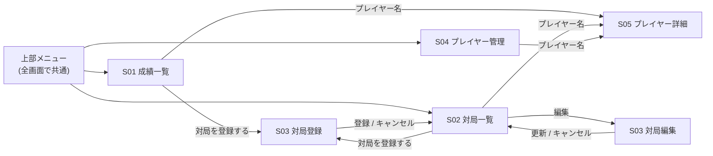

# 画面設計

要件定義書([機能要件.md](機能要件.md))と DB 設計書([DB設計.md](DB設計.md))に基づく画面設計(第1段階: MVP)。

## 1. 画面一覧

| No. | 画面名 | URL | 説明 |
|-----|--------|-----|------|
| S01 | 成績一覧(トップ) | `/` | プレイヤーごとの成績を表示する |
| S02 | 対局一覧 | `/games` | 対局を新しい順に表示する。編集・削除への導線を持つ |
| S03 | 対局登録・編集 | `/games/new`(登録)、`/games/edit?id=1`(編集) | 対局の入力フォーム。登録と編集で同じ画面を使う |
| S04 | プレイヤー管理 | `/players` | プレイヤーの登録・編集・削除 |
| S05 | プレイヤー詳細 | `/players/detail?id=1` | 選んだプレイヤーの対局履歴と成績を表示する |

> **URL に ID をクエリ(`?id=1`)で渡す理由**: フロントエンドは Next.js の静的エクスポートで作るため、`/players/1` のように「あとから増える ID」ごとの画面を事前に作れない。そのため、1つの画面にクエリで ID を渡す形にする。

## 2. 画面の移動



### 2.1 上部メニュー(全画面で共通)

```
┌────────────────────────────────────────────────────────┐
│ 麻雀成績管理   [成績]  [対局]  [プレイヤー]              │
└────────────────────────────────────────────────────────┘
```

| メニュー | 移動先 |
|---------|--------|
| 成績 | S01 |
| 対局 | S02 |
| プレイヤー | S04 |

今開いている画面のメニューは、強調して表示する。

## 3. 各画面

### 3.1 S01 成績一覧

```
成績一覧                                            [＋ 対局を登録する]
┌──────┬──────┬────────┬──────┬────────── 順位の回数 ──────────┬──────┬──────┬────────┐
│      │      │        │      ├──────┬──────┬──────┬──────┤      │      │        │
│ 名前 │対局数│通算スコア▼│平均順位│  1位  │  2位  │  3位  │  4位  │トップ率│ラス率│最高素点│
├──────┼──────┼────────┼──────┼──────┼──────┼──────┼──────┼──────┼──────┼────────┤
│ 田中 │  12  │  +45.3 │ 2.21 │  4.00│  3.50│  2.50│  2.00│ 33.3%│ 16.7%│ 58,000 │
│ 佐藤 │  10  │  +12.0 │ 2.40 │  3.00│  2.00│  3.00│  2.00│ 30.0%│ 20.0%│ 47,500 │
│ ...  │      │        │      │      │      │      │      │      │      │        │
└──────┴──────┴────────┴──────┴──────┴──────┴──────┴──────┴──────┴──────┴────────┘
```

| 項目 | 内容 |
|------|------|
| 「＋ 対局を登録する」ボタン | 画面の右上に、目立つ色(オレンジ)で置く。押すと S03(登録)に移動する。一番よく使う操作なので、S01 と S02 の両方に置く |
| 表示するプレイヤー | 削除されていないプレイヤーのみ(削除済みは表示しない) |
| 表示項目 | 名前、対局数、通算スコア、平均順位、順位の回数(1位・2位・3位・4位を別々の列)、トップ率、ラス率、最高素点 |
| 順位の回数の列 | 小数点の位置が揃うように、1位〜4位を別の列にして、右寄せ・小数第2位までの固定の桁数(例: 4.00、1.83)で表示する |
| 最高素点 | 1回の対局での素点の最大値(例: 58,000)。色はつけない |
| 並び順 | 初期は通算スコアの高い順。項目名を押すと、その項目で並び替える(もう一度押すと昇順・降順が切り替わる) |
| 名前を押したとき | そのプレイヤーの S05 に移動する |
| 対局が0件のプレイヤー | 対局数は 0、ほかの項目は「-」と表示する。並び替えでは最後に置く |
| データがないとき | 「プレイヤーが登録されていません」と表示し、S04 への案内を出す |

### 3.2 S02 対局一覧

```
対局一覧                                            [＋ 対局を登録する]
┌────────────────────────────────────────────────────────┐
│ 2026-11-22              ※供託 1,000点   [編集] [削除]   │
│ ┌──────────┬──────┬────────┬────────┐                  │
│ │ 名前     │ 順位 │ 素点   │ スコア │                  │
│ │ 田中     │  1   │ 42,500 │ +42.5  │                  │
│ │ 佐藤     │  2   │ 31,000 │ +11.0  │                  │
│ │ 鈴木     │  3   │ 28,000 │ −12.0  │                  │
│ │ 高橋     │  4   │ 18,500 │ −41.5  │                  │
│ └──────────┴──────┴────────┴────────┘                  │
└────────────────────────────────────────────────────────┘
(以下、古い対局が続く)
```

| 項目 | 内容 |
|------|------|
| 並び順 | 対局日の新しい順。同じ日は登録が新しい順 |
| 1件の表示 | 対局日、供託、4人分の名前・順位・素点・スコア(順位順) |
| 供託の表示 | 供託が 0 でない対局だけ、「編集」ボタンの左に「※供託 1,000点」の形で表示する |
| 表の列幅 | 名前・順位・素点・スコアの列幅を固定し、どの対局の表でも列が縦にそろうようにする(「削除されたプレイヤー」のような長い名前があっても、列がずれない) |
| スコアの色 | プラスは青、マイナスは赤で表示する(S01・S05 も同じ) |
| 同点の順位 | 1.5位のように、小数のまま表示する |
| 削除済みのプレイヤー | 名前の代わりに「削除されたプレイヤー」と表示する(S05 へのリンクはつけない) |
| 名前を押したとき | そのプレイヤーの S05 に移動する |
| 「＋ 対局を登録する」 | 画面の右上に、目立つ色(オレンジ)で置く。S03(登録)に移動する |
| 「編集」 | S03(編集)に移動する |
| 「削除」 | 確認ダイアログ(「この対局を削除しますか?元に戻せません」)で「削除する」を押すと削除し、一覧を更新する |
| データがないとき | 「対局が登録されていません」と表示する |

MVP では、全件を1ページに表示する(ページ送りは対象外)。

### 3.3 S03 対局登録・編集

```
対局を登録する                           (編集のときは「対局を編集する」)
 対局日   [ 2026-11-22 ]
 供託     [    0 ] 点

 1人目    [ プレイヤーを選択 ▼ ]   素点 [        ] 点
 2人目    [ プレイヤーを選択 ▼ ]   素点 [        ] 点
 3人目    [ プレイヤーを選択 ▼ ]   素点 [        ] 点
 4人目    [ プレイヤーを選択 ▼ ]   素点 [        ] 点

 合計: 素点 0 + 供託 0 = 0 点   (あと 120,000 点)

              [キャンセル]   [登録する]
```

| 項目 | 内容 |
|------|------|
| 対局日 | 初期値は今日 |
| 供託 | 初期値は 0 |
| プレイヤーの選択 | 削除されていないプレイヤーだけが選択肢に出る。すでに別の欄で選んだプレイヤーは選べない |
| 素点の入力 | 数字(マイナス可)。100点単位 |
| 合計の表示 | 入力するたびに「素点の合計 + 供託」を表示し、120,000点との差を示す。ちょうど 120,000点のとき、緑色で「OK」と表示する |
| 登録するボタン | 下の入力チェックをすべて満たすまで押せない |
| 登録・更新に成功したとき | S02 に移動する |
| キャンセル | 入力を捨てて S02 に移動する |
| 編集のとき | 登録済みの内容を初期値として表示する。編集する対局に削除済みのプレイヤーがいる場合は、そのプレイヤーを選択肢に追加して選んだ状態にする |

順位とスコアは入力せず、登録後に自動で計算される(S03 では表示しない)。

#### 入力チェック

| チェック | エラーメッセージ |
|---------|----------------|
| 対局日が未入力 | 対局日を入力してください |
| プレイヤーが4人そろっていない | 4人のプレイヤーを選択してください |
| 同じプレイヤーを重複して選んだ | 同じプレイヤーを重複して選べません |
| 素点が4人分そろっていない | 4人分の素点を入力してください |
| 素点が100点単位でない | 素点は100点単位で入力してください |
| 供託が負の数、または100点単位でない | 供託は0以上の100点単位で入力してください |
| 素点の合計 + 供託 が 120,000 でない | 素点の合計と供託の合計が 120,000点になっていません(現在: ○○点) |

同じチェックをバックエンドでも行う(画面のチェックは、すぐ気づけるようにするためのもの)。

### 3.4 S04 プレイヤー管理

```
プレイヤー管理
 新規登録: [ 名前を入力 ] [登録する]

┌────────┬───────────────┐
│ 名前   │ 操作          │
├────────┼───────────────┤
│ 田中   │ [編集] [削除] │
│ 佐藤   │ [編集] [削除] │
└────────┴───────────────┘
```

| 項目 | 内容 |
|------|------|
| 表示するプレイヤー | 削除されていないプレイヤーのみ |
| 新規登録 | 名前を入力して「登録する」。成功したら一覧に追加する |
| 編集 | 「編集」を押すと、その行の名前が入力欄に変わり、「保存」「キャンセル」が出る |
| 削除 | 確認ダイアログ(「○○さんを削除しますか?過去の対局は残り、『削除されたプレイヤー』と表示されます」)で「削除する」を押すと論理削除する |
| 名前を押したとき | そのプレイヤーの S05 に移動する |

#### 入力チェック

| チェック | エラーメッセージ |
|---------|----------------|
| 名前が未入力(空白だけも含む) | 名前を入力してください |
| 21文字以上 | 名前は20文字以内で入力してください |
| 削除されていないプレイヤーと名前が重複 | その名前はすでに登録されています |

### 3.5 S05 プレイヤー詳細

```
田中さんの成績
┌─────────┬──────────┬─────────┬─────────┬──────────┐
│ 対局数  │ 通算スコア │ 最高素点 │ 平均順位 │ トップ率 │ ラス率  │
│   12    │  +45.3   │  58,000 │  2.21   │ 33.3%   │ 16.7%  │
└─────────┴──────────┴─────────┴─────────┴─────────┴────────┘
 順位の回数  1位 4回 / 2位 3.5回 / 3位 2.5回 / 4位 2回

対局履歴
┌───────────┬──────┬────────┬────────┬─────────────────────────────────────┐
│ 対局日    │ 順位 │ 素点   │ スコア │ 同卓者(順位・点数)                   │
├───────────┼──────┼────────┼────────┼─────────────────────────────────────┤
│ 2026-11-22│  1   │ 42,500 │ +42.5  │ 佐藤 2位 31,000点  鈴木 3位 28,000点  │
│           │      │        │        │ 高橋 4位 18,500点                    │
│ 2026-11-20│ 1.5  │ 36,000 │ +26.0  │ 山田 1.5位 36,000点 …                │
└───────────┴──────┴────────┴────────┴─────────────────────────────────────┘
```

| 項目 | 内容 |
|------|------|
| 成績の項目 | 対局数、通算スコア、最高素点、平均順位、1〜4位の回数、トップ率、ラス率(S01 と同じ計算) |
| 対局履歴 | そのプレイヤーが参加した対局を、対局日の新しい順に表示する。表示項目は対局日、順位、素点、スコア、同卓者 |
| 同卓者 | その対局の他の3人について、名前・順位・点数(素点)を順位順に表示する。「どの対局だったか」を思い出す手がかりにするため、点数は最終スコアではなく素点で表示する。削除済みのプレイヤーは「削除されたプレイヤー」と表示する |
| 対局が0件のとき | 成績は「-」、履歴は「対局がありません」と表示する |
| 存在しない ID | 「プレイヤーが見つかりません」と表示し、S01 への案内を出す |

## 4. 表示のルール

| 項目 | 表示 |
|------|------|
| スコア | 小数第1位まで。プラスには「+」をつける(例: +42.5、−12.0) |
| 素点 | 3桁区切り(例: 42,500) |
| 平均順位 | 小数第2位まで(例: 2.21) |
| 順位(同点) | 1.5、2.5 のように小数のまま。整数のときは整数(例: 1) |
| 順位の回数(S01 の表) | 小数点の位置が揃うよう、常に小数第2位まで(例: 4.00、1.83、0.33)。右寄せで表示する |
| 順位の回数(S05 の文章) | 小数が出るときだけ小数第2位まで(例: 4回、3.5回、0.33回) |
| スコアの色 | プラスは青、マイナスは赤 |
| 表の罫線 | 縦線は薄い色にして、主張を抑える |
| トップ率・ラス率 | パーセントで、小数第1位まで(例: 33.3%) |
| 日付 | 西暦の `YYYY-MM-DD` |
| マイナスの記号 | スコアには「−」(マイナス記号)を使う |

## 5. 共通の動作

| 場面 | 動作 |
|------|------|
| 読み込み中 | 「読み込み中...」を表示する |
| 通信エラー | 「通信に失敗しました。しばらくしてからもう一度お試しください」と表示する |
| 登録・更新・削除の成功 | 画面の上部に、短い成功メッセージを表示する(例: 「対局を登録しました」) |
| 削除 | 必ず確認ダイアログを出す |

## 6. 対象外(MVP)

- スマートフォン向けの画面最適化(「余力があれば」)
- 対局一覧のページ送り、絞り込み
- 登録前の順位・スコアのプレビュー表示
- グラフ表示
